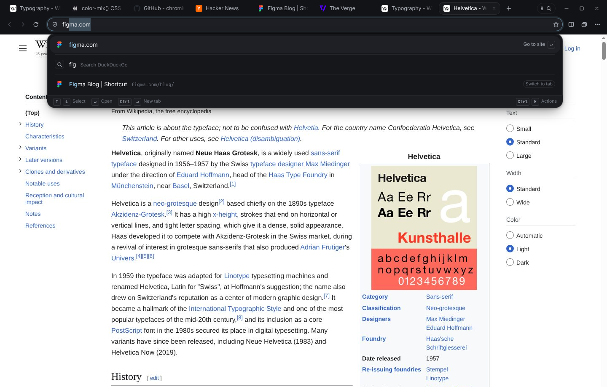

# Sift

**The web, without the mess.** Sift is a desktop web browser built on Chromium (via CEF). It keeps the browser you already know (address bar, tabs, back and forward, bookmarks, history, downloads) and makes the everyday parts faster and calmer.



## What's different

- **An address bar that knows your browser.** Type a few letters and one ranked list shows the site you mean (completed inline), open tabs to switch to, history, bookmarks, recently closed tabs, your Moments and browser actions. Arrow keys move, Enter goes, Escape backs out. Ctrl/Cmd+K puts the same field into **Actions** mode; there is no second command palette.
- **Tab search that works at 100 tabs.** Ctrl/Cmd+Shift+A, or click the tab counter. Search by title or address, see a live thumbnail of the selected tab, switch with Enter, select several with Space and close them or save them as a Moment. **Tidy** suggests closing duplicates and tabs you haven't opened in a week. It only suggests: nothing closes until you choose, and every close can be undone.
- **Moments.** Save a set of tabs under a name ("Website redesign", "Lisbon trip"), close them, and bring the whole set back later in the same order, with split view and scroll position where possible. Moments are local files: no account, no sync, no AI.
- **Side by side.** Ctrl/Cmd+\\, "Open Side by Side" in a tab's menu, or drag a tab down into the page. Two live pages with their own navigation, a resizable divider, a swap button and one click back to normal.
- **Hover previews.** Hover a tab for its title, address, when you last looked at it and a thumbnail.
- **Honest privacy.** Requests to a bundled list of known tracker domains are blocked, and the site panel shows exactly which domains were blocked on the page. Third-party cookies are blocked by default. Search suggestions, the only thing that would send your keystrokes anywhere, are off until you turn them on.

More screenshots are in [`docs/screenshots/`](docs/screenshots) and the design notes are in [`docs/DESIGN.md`](docs/DESIGN.md).

## Build and run

Sift is a C++ CEF host (`native/`) plus a UI written in plain HTML, CSS and JavaScript modules (`app/`) that the host loads from `sift://app/`.

```sh
scripts/build.sh            # downloads CEF 156 (~330 MB) into third_party/cef, then builds
build/Release/sift          # Linux; build/Release/sift.exe on Windows
```

Requirements: CMake 3.21+, a C++20 compiler, and on Linux the X11 development headers. CEF's binary distribution brings its own Chromium. Pass a URL to open it: `build/Release/sift https://example.com`. User data lives in `~/.config/sift` (Linux), `%LOCALAPPDATA%\Sift\User Data` (Windows) or `~/Library/Application Support/Sift` (macOS); set `SIFT_USER_DATA` to use another folder.

Other commands:

```sh
npm test                    # unit tests for the address bar ranking, tidy, Moments, URL handling, bookmark import/export
npm run preview             # serve the UI in an ordinary browser at http://localhost:4280 (see below)
```

`npm run preview` runs the same UI against a stand-in bridge that renders pages in iframes. It's for working on the interface only: many sites refuse to load in an iframe, and there are no downloads, permissions, tracker blocking or thumbnails. Real browsing needs the CEF build.

## What works, and what needs more engine work

"Verified" means I exercised it in the CEF build on Linux (Chromium 156), driving the real window with keyboard and mouse input, while writing this README. "Implemented" means the code is in place but hasn't been exercised end to end yet.

| Area | Status |
| --- | --- |
| Browsing, back/forward/reload, page zoom, find in page, view source | Verified |
| Print, DevTools | Implemented |
| Address bar: inline completion, open tabs, history, bookmarks, closed tabs, Moments, Actions mode | Verified |
| Default search (DuckDuckGo) | Verified; switching engines is implemented |
| Opt-in search suggestions | Implemented |
| Tabs: new, close, reopen closed, drag to reorder, pin, duplicate | Verified; mute is implemented |
| Tab search, Tidy suggestions, closing via Tidy with Undo | Verified |
| Hover previews with page thumbnails | Verified (thumbnails come from the DevTools protocol) |
| Moments: save (and close), restore, rename, delete with Undo | Verified; export/import and "open in new window" are implemented |
| Split view: drag a tab into the page, live panes, resize, focus, swap, exit | Verified |
| History, bookmarks (Ctrl/Cmd+D), New Tab frequent sites | Verified |
| Downloads saved to ~/Downloads, toolbar panel | Verified; pause/resume/cancel are implemented |
| Session restore (only the visible tab loads at startup) | Verified; optional tab sleeping is implemented |
| Permission prompts with per-site memory | Verified with a location request |
| Tracker blocking (98-domain list, per-page report), third-party cookie blocking, Do Not Track, clear cache | Verified; clearing cookies and history is implemented |
| Private windows (separate in-memory profile, no history written) | Verified |
| Profiles | Implemented |
| Bookmark import from Chrome, Edge, Brave, Arc, Vivaldi, Chromium profiles or a bookmarks HTML file; HTML export | Parsers unit-tested; the import UI is implemented |
| Light and dark appearance | Verified |
| Windows build | Code and CMake in place; not built yet |
| macOS build (Apple Silicon) | Built against the macOS 26 SDK and tested in CI (`.github/workflows/macos.yml`) with real mouse and keyboard input: traffic lights centred on the tab row, tab clicks in the title bar, page focus, address bar results |
| Chrome extensions | Not available. Sift's tabs use CEF's Alloy runtime (CEF permits only one Chrome-style view per window) and Alloy doesn't host extensions. See [`docs/ARCHITECTURE.md`](docs/ARCHITECTURE.md). |
| Built-in password manager, autofill | Not available, for the same reason. Third-party password managers would need extension support. |
| Importing history and saved passwords from other browsers | Not implemented |
| Sync | Not planned; Sift works without an account |

## Keyboard

| | Linux / Windows | macOS |
| --- | --- | --- |
| Address bar | Ctrl+L | ⌘L |
| Actions | Ctrl+K | ⌘K |
| Search tabs | Ctrl+Shift+A | ⇧⌘A |
| Save tabs as a Moment | Ctrl+Shift+S | ⇧⌘S |
| Side by side | Ctrl+\\ | ⌘\\ |
| New tab / close tab / reopen closed | Ctrl+T / Ctrl+W / Ctrl+Shift+T | ⌘T / ⌘W / ⇧⌘T |
| Next / previous tab, tab 1–8, last tab | Ctrl+Tab / Ctrl+Shift+Tab, Ctrl+1–8, Ctrl+9 | same with ⌘ for numbers |
| Find, bookmark, zoom | Ctrl+F, Ctrl+D, Ctrl+= / − / 0 | ⌘F, ⌘D, ⌘= / − / 0 |
| New window / private window | Ctrl+N / Ctrl+Shift+N | ⌘N / ⇧⌘N |
| Close any overlay | Esc | Esc |

Shortcuts work while a web page has focus: the host forwards them to the UI before the page sees them.

## Repository layout

```
app/          the UI: index.html, styles/, src/ (core/ is pure logic, ui/ is views), fonts, icons, tracker list
native/       the CEF host: window and layout, clients, sift:// scheme, storage, tracker matching
scripts/      fetch-cef.sh, build.sh, preview.mjs
tests/        node:test unit tests for app/src/core
docs/         ARCHITECTURE.md, DESIGN.md, screenshots/
```

Fonts: the system font on macOS and Windows; Inter (SIL Open Font License, `app/fonts/`) on Linux.
